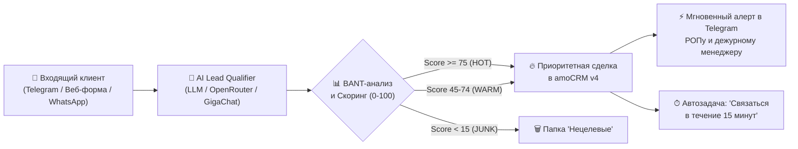

# 🤖 AI Lead Qualifier & Pipeline Router

> **Интеллектуальная B2B-квалификация входящих лидов (BANT), автоматическое определение направления продаж («Проекта»), автомаршрутизация сделок в amoCRM и мгновенные алерты в Telegram руководителей направлений.**

[](tests/)
[](https://python.org)
[](https://www.amocrm.ru)
[](LICENSE)

**▶️ Интерактивное веб-демо:** https://kilevoy.github.io/ai-lead-qualifier/

---

## 🏛 Направления продаж (Проекты)

В многопрофильных промышленных компаниях входящий поток лидов требует не просто фиксации контакта, а **моментального распределения по специализированным проектным группам**:

1. **🏭 Проект «Ангары и быстровозводимые здания»:**
   * Металлокаркасы, склады, ангары из ЛСТК и чёрного металла, производственные корпуса, СТО.
   * Выявление параметров: площадь ($м^2$), высота, тёплый/холодный контур, проект КМ.
2. **🏢 Проект «Кровли и фасадные системы»:**
   * Навесные вентилируемые фасады (НФС), фасадные кассеты (КФ-1...КФ-4), металлосайдинг, профлист, сэндвич-панели, подконструкция.
   * Выявление параметров: площадь фасада ($м^2$), тип кассет/панелей, толщина металла.
3. **🧱 Проект «Автоклавный газобетон»:**
   * Стеновые блоки автоклавного твердения, перемычки, клей.
   * Выявление параметров: объём ($м^3$), марка плотности (D400, D500, D600), толщина блока, плечо доставки.

---

## 🎯 Бизнес-проблема и эффект (ROI)

* **Проблема:** До 40% рабочего времени B2B-менеджеров уходит на пустые первичные созвоны с нецелевыми лидами или теми, у кого нет бюджета. При этом среднее время реакции на входящую заявку с сайта или из мессенджера — 2–4 часа.
* **Решение:** AI-квалификатор моментально вступает в диалог на первой линии, ненавязчиво выявляет ключевые параметры сделки (BANT), отсеивает мусорные обращения и за 15 секунд передаёт горячего лида менеджеру с уже заполненной карточкой в CRM.

| Метрика | До внедрения | После внедрения AI-агента |
| :--- | :--- | :--- |
| **Скорость первого ответа** | 2–4 часа (в нерабочее время — до утра) | **Мгновенно (< 15 секунд, 24/7)** |
| **Конверсия первого контакта в квалифицированный лид** | ~18% (лиды остывают) | **34% (+16 п.п.)** |
| **Время менеджера на квалификацию** | 20–30 мин на звонок и ручное занесение | **0 мин (получает готовую карточку с саммари)** |
| **Потери заявок в нерабочее время** | До 35% | **0% (сделка сразу встаёт в очередь задач)** |

---

## 🏗 Архитектура процесса



---

## ⚙️ Ключевые возможности

1. **Квалификация по стандарту BANT:**
   * **Need (Потребность):** выявление типа объекта, объёмов, наличия готового ТЗ/проекта.
   * **Authority (ЛПР):** определение статуса собеседника (генеральный директор, главный механик, снабжение).
   * **Timeline (Сроки):** фиксация срочности (горит / плановый срок).
   * **Budget (Бюджет):** выявление ценовых ожиданий или утверждённого лимита.
2. **Интеграция с amoCRM (Kommo):**
   * Создание контакта с телефоном и email.
   * Создание сделки с автозаполнением бюджета, кастомных полей («AI Скоринг», «AI Саммари», «Сроки»).
   * Автоматическая постановка задачи ответственному менеджеру с таймером на 15 минут.
3. **Двухрежимная работа (Live & Mock):**
   * Поддержка реальных LLM-провайдеров через OpenAI-совместимый API (OpenRouter, DeepSeek, GigaChat, YandexGPT, Ollama).
   * Встроенный детерминированный эвристический движок для тестирования и CI/CD без платных API-ключей (`MOCK_MODE=True`).
4. **Уведомления в Telegram:**
   * Форматированные HTML-карточки лидов с цветовой индикацией статуса (HOT/WARM/COLD) и прямой ссылкой на сделку в CRM.

---

## 🚀 Быстрый старт

### 1. Клонирование и установка зависимостей
```bash
git clone https://github.com/kilevoy/ai-lead-qualifier.git
cd ai-lead-qualifier
pip install -r requirements.txt
```

### 2. Запуск тестов
```bash
python -m pytest
```

### 3. Настройка окружения
Скопируйте пример конфига:
```bash
cp .env.example .env
```
*(Для работы в демонстрационном режиме без API-ключей оставьте `MOCK_MODE=True`).*

### 4. Запуск локального API и веб-демо
```bash
uvicorn qualifier.api:app --reload --port 8000
```
Откройте в браузере: `http://localhost:8000`

---

## 📁 Структура проекта

```text
ai-lead-qualifier/
├── qualifier/                 # Ядро пакета
│   ├── __init__.py
│   ├── models.py              # Pydantic-модели (BANT, LeadProfile, Scoring)
│   ├── prompts.py             # B2B-промпты квалификации и экстракции
│   ├── agent.py               # Диалоговый движок (LLM + Heuristics fallback)
│   ├── crm.py                 # Клиент amoCRM REST API v4 (сделки, контакты, задачи)
│   ├── telegram.py            # Генератор HTML-карточек и отправка в Telegram
│   └── api.py                 # FastAPI сервер и эндпоинты вебхуков
├── tests/                     # Автоматические тесты (Pytest)
│   └── test_qualifier.py
├── web/                       # Интерактивное веб-демо (GitHub Pages)
│   └── index.html
├── .env.example               # Шаблон конфигурации
├── requirements.txt           # Зависимости
├── pytest.ini                 # Конфигурация тестов
└── README.md                  # Документация проекта
```

---

## 👨‍💼 Автор

**Андрей Рыкунов** — коммерческий руководитель с 26-летним опытом в B2B и автоматизации бизнес-процессов.
* Portfolio: [kilevoy.github.io](https://kilevoy.github.io)
* GitHub: [@kilevoy](https://github.com/kilevoy)
* Telegram: [@rykunov](https://t.me/rykunov)
* Email: rykunov@gmail.com

